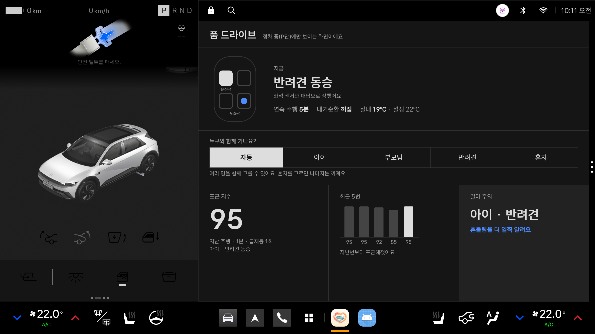
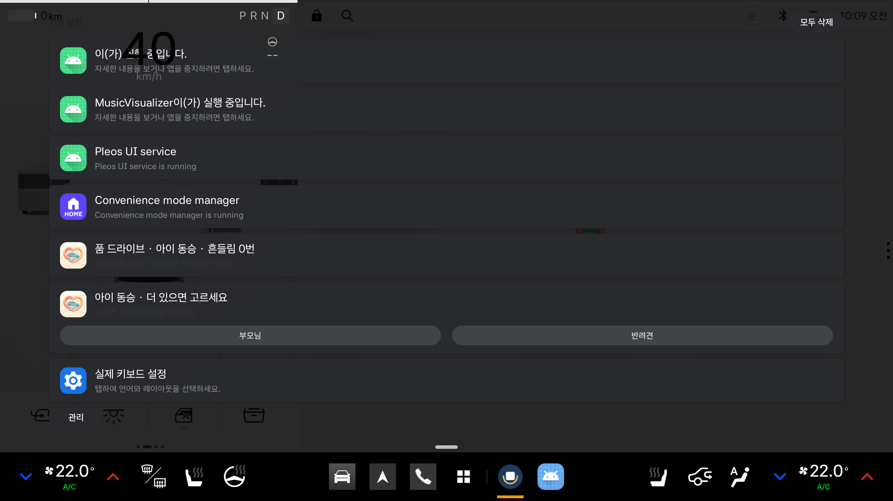

# 에뮬레이터 기능 검증 결과

Pleos Connect Emulator v2.1.0에서 앱의 핵심 기능을 시험한 결과입니다. 차량 상태는 Virtual Console로 바꾸고, 운전자 대답은 미리 합성한 음성('응', '아니', '아이요', '아이랑 강아지요' 등)을 온디바이스 음성 인식기에 입력해 확인했습니다. 차량 전원 꺼짐·켜짐은 에뮬레이터 종료와 재시작으로 재현했습니다.

## 결과
| 확인 항목 | 결과 |
|---|---|
| 주행 중(주행 제한 상태) 음성 안내 재생 | 정상 |
| 주행 중 앱 화면 차단 | 시스템 차단 확인, 앱 자체 가림 화면 동작 |
| 탑승 감지 → "누구와 함께 가세요?" → "아이요" → 아이 동승 | 정상 |
| 여러 동승자 대답 → 기능 합치기 | 정상 ("아이랑 강아지요" → 아이·반려견 동승, 출발 전 안내 9초: 카시트·반려견 안전장비 점검 후 동화 제안) |
| 여러 동승자 안내 문구와 기준 | 정상 (급가속 시 "아이와 반려견이 뒤로 쏠렸어요", 실내가 설정보다 2℃ 높을 때 더위 안내) |
| 카시트·반려견 안전장비 점검은 하루 첫 출발에만 | 정상 (같은 날 두 번째 반려견 탑승 시 생략) |
| 좌석이 빈 채 뒷문 열림·닫힘 → "뒷좌석에 누가 탔나요?" | 정상 (닫힌 뒤 2초에 질문, "강아지" → 반려견 동승) |
| 동승자를 확인하기 전에 출발 | 정상 (가장 조심스러운 기준 적용: 초당 8km/h 가속 감지, 첫 정차에서 1회 재질문, 인식 실패 시 알림 표시) |
| 주행 중(D단, 시속 40km) 알림 센터에서 동승자 선택 | 정상 ([아이] → "아이와 함께 가는 걸로 살필게요" → 남은 [부모님]·[반려견] 표시 → [반려견] → 아이·반려견 동승) |
| 카시트 점검 안내 → 동화 제안 → "응" → 출발 후 동화 낭독 | 정상 |
| 급제동(초당 25km/h 감속)·급회전(시속 40km, 조향 120°) 감지와 안내 | 정상, 부드러운 출발·정지는 제외 |
| 급가속(초당 20km/h 가속) 감지와 안내 | 정상 (가속 시작 후 약 0.8초), 부드러운 가속(초당 5km/h)은 제외 |
| 동화 낭독 중 급제동 안내 끼어들기와 이어 읽기 | 정상 (문장마다 0.55초, 문단마다 1.1초 쉬어 가며 낭독, 안내가 끝나면 끊긴 문장부터 다시 읽기) |
| 2시간 연속 주행 → 휴식 제안 → "응" → 가장 가까운 졸음쉼터 길안내 | 정상 (성남 졸음쉼터, 4.7km) |
| 길안내 중 휴식 제안 → "응" → 경유지 추가 | 정상 (경유지 요청 1초, 재탐색 9~10초) |
| 휴식 제안에 "아니" 또는 무응답 | 재질문 후 안내 없이 종료 |
| 내기순환 60분 환기 안내, 실내 온도 더위 안내 | 정상 |
| 혼자 모드 신호 대기 자세 안내 | 정상 |
| 도착 후 포근 지수와 멀미 확인 기록 (20분 이상 주행) | 정상 (45분 주행 중 급가속 1회 → "오늘 포근 지수는 97점이에요") |
| 20분 미만 주행은 안내·질문 없이 기록만 | 정상 (1분 주행) |
| 도착 후 멀미 질문에 "아니" → 탑승한 동승자 모두 기록 | 정상 (아이·반려견 모두 멀미 주의) |
| 멀미 기록이 있는 동승자 탑승 시 안내 기준 하향 | 정상 (초당 8km/h 가속: 반려견 모드 미감지, 멀미 기록이 있는 부모님 모드 감지) |
| 상시 알림 제목에 탑승 모드와 포근 지수 표시 | 정상 ("품 드라이브 · 부모님 동승 · 지난 주행 포근 지수 97") |
| 정차 화면 낮·밤 테마 | 정상 (시스템 야간 모드 전환 시 색상 변경, 시연 메뉴는 제목을 3초 누를 때만 표시) |
| 앱 프로세스 강제 종료 후 자동 재시작과 기록 유지 | 정상 (5.5초) |
| 전원 꺼짐 → 켜짐 후 서비스 자동 시작 | 정상 (앱 실행 없이 부팅 완료 후 3.7~5.7초) |
| 전원이 꺼져 있던 시간을 정차 시간으로 반영 | 정상 (104초 꺼짐을 34분 정차로 계산해 연속 주행 시간 초기화, 시간 압축 20배) |
| 케어 서비스가 종료된 상태에서 휴대폰 연결 → 재시작 | 정상 (앱 화면이 떠 있으면 바로 재시작 후 "휴대폰이 연결돼서 품 드라이브를 다시 켰어요", 앱이 뒤에 있으면 시작 알림과 음성 안내 → [시작] → "품 드라이브를 다시 시작했어요". 블루투스 연결 신호는 시연 명령으로 대체) |
| Suspend 복귀 시 대기 중이던 음성 안내 폐기 | 정상 (시연 명령으로 30분 절전 복귀 재현, 재생 중 안내와 대기 질문 2건 폐기) |

## 화면
| 정차 중 화면 (낮) | 정차 중 화면 (밤) |
|---|---|
|  |  |

| 주행 중 시스템 차단 | 주행 중 알림 센터에서 동승자 선택 |
|---|---|
|  |  |

| 휴식 제안 → 졸음쉼터 길안내 | 길안내 중 경유지 추가 |
|---|---|
|  |  |

## 확인된 플랫폼 특성과 대응
- Vehicle SDK 2.3.2의 좌석 탑승 값이 차량 표준(VehicleSeatOccupancyState)과 반대로 전달되어 앱에서 보정합니다.
- 에뮬레이터 내비게이션은 경로 옵션 변경 요청을 반영하지 않아 핵심 기능에서 제외했습니다.
- NaviHelper의 경유지는 최대 2개이며, 가득 찬 경우 음성으로 안내합니다.
- 장소는 좌표만으로 요청하며(POI ID 불필요), 주소는 내비게이션이 채웁니다.
- Suspend 복귀 시 앱이 메모리에 남아 이어서 동작하는 것은 Pleos 개발 문서(Suspend 모드 가이드)로 확인했으며, 에뮬레이터 시험으로는 확인하지 못했습니다. 에뮬레이터(사용자 빌드)에서는 Suspend를 재현할 수 없습니다. `cmd car_service suspend`는 사용자 빌드에서 차단되며, Virtual Console의 전원 상태 값은 전기차 동력 상태만 변경합니다. Suspend 복귀 시에도 실제 경과 시간(elapsedRealtime, 절전 시간 포함)으로 꺼져 있던 시간을 계산하도록 구현했으며, 실차에서 확인할 예정입니다.
- Suspend 중 앱이 종료된 경우에 대비해, 휴대폰 블루투스 연결 신호(`ACTION_ACL_CONNECTED`, 종료된 앱도 받는 예외 브로드캐스트)를 받으면 먼저 서비스를 바로 시작합니다. Android 12 이상은 백그라운드 앱의 포그라운드 서비스 시작을 예외 목록으로만 허용하며 블루투스 연결은 목록에 없으므로, 시작이 거부되면 시작 알림을 띄우고 음성으로 "알림 센터에서 시작을 누르면 품 드라이브가 다시 살펴요"라고 안내합니다. Pleos는 이 알림을 화면 위에 띄우지 않아 음성 안내를 더했습니다. 운전자가 알림의 [시작]을 누르면 서비스가 시작됩니다. 에뮬레이터 v2.1.0은 블루투스 연동을 지원하지 않아 연결 신호는 시연 명령으로 대체했습니다.
- 백그라운드 시작 예외 중 '배터리 최적화 예외'는 Pleos(AAOS)에 요청 화면이 없어(시스템 스텁) 사용할 수 없습니다.
- 에뮬레이터에서 3D 주행 화면이 동작하면 CPU가 부족해 음성이 끊기는 현상이 있습니다(3D 화면 단독 CPU 약 120%, 오디오 믹서 지연 평균 130ms). 실차 하드웨어와 무관한 에뮬레이터 현상이며, 시연 영상의 음성은 3D 화면을 끈 상태에서 문장마다 5번 이상 따로 녹음해 끊김 없는 녹음을 골라 사용했습니다.
- 주행 중 사용 가능(Distraction Optimization) 선언은 adb로 설치한 앱에서 인정되지 않았습니다. 시스템의 주행 중 허용 목록에는 Pleos 기본 앱만 포함되어 있습니다. 시스템 화면인 알림 센터의 버튼은 주행 중에도 동작하므로, 주행 중에는 동승자 선택만 알림으로 제공합니다.
- 같은 앱의 알림이 여러 개이면 시스템이 하나로 묶어 버튼이 가려지므로, 알림마다 그룹을 따로 지정합니다.
- Pleos 알림 센터에서 이 앱 알림의 본문이 흐리게 표시되어(제목은 정상), 탑승 모드와 포근 지수 등 핵심 정보를 알림 제목에 표시합니다. 주행 중 팝업은 띄우지 않으며, 알림 센터를 열 때만 보입니다.
- Pleos Suspend 모드 가이드("Suspend 이후 Resume 시에는 이전 오디오 상태를 그대로 복원하지 않습니다")에 따라, 30초 이상 동작하지 못한 뒤 복귀하면 대기 중이던 음성 안내와 질문을 재생하지 않고 폐기합니다.
