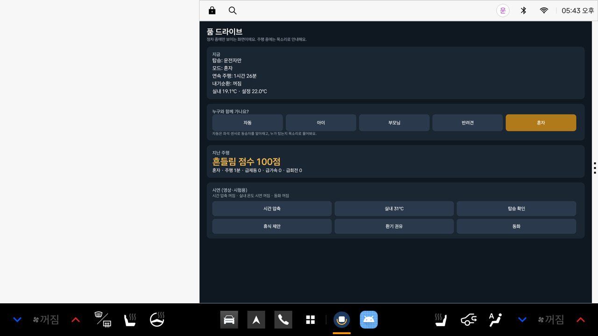
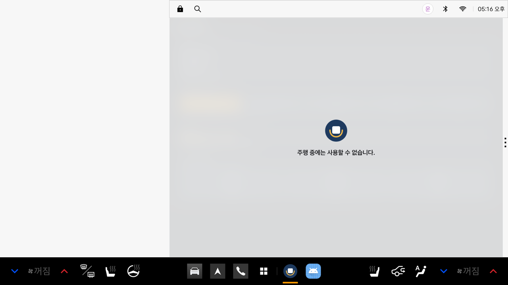
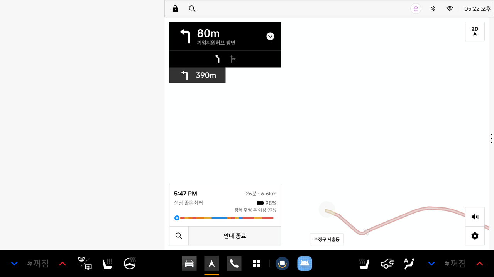

# 에뮬레이터 기능 검증 결과

Pleos Connect Emulator v2.1.0에서 앱의 핵심 기능을 시험한 결과입니다. 차량 상태는 Virtual Console로 바꾸고, 운전자 대답은 미리 합성한 음성('응', '아니', '아이요' 등)을 온디바이스 음성 인식기에 입력해 확인했습니다.

## 결과
| 확인 항목 | 결과 |
|---|---|
| 주행 중(주행 제한 상태) 음성 안내 재생 | 정상 |
| 주행 중 앱 화면 차단 | 시스템 차단 확인, 앱 자체 가림 화면 동작 |
| 탑승 감지 → "누구와 함께 가세요?" → "아이요" → 아이 모드 | 정상 |
| 카시트 점검 안내 → 동화 제안 → "응" → 출발 후 동화 낭독 | 정상 |
| 급제동(초당 25km/h 감속)·급회전(시속 40km, 조향 120°) 감지와 안내 | 정상, 부드러운 출발·정지는 제외 |
| 동화 낭독 중 급제동 안내 끼어들기와 이어 읽기 | 정상 |
| 2시간 연속 주행 → 휴식 제안 → "응" → 가장 가까운 졸음쉼터 길안내 | 정상 (성남 졸음쉼터, 4.7km) |
| 길안내 중 휴식 제안 → "응" → 경유지 추가 | 정상 (경유지 요청 1초, 재탐색 9~10초) |
| 휴식 제안에 "아니" 또는 무응답 | 재질문 후 안내 없이 종료 |
| 내기순환 60분 환기 안내, 실내 온도 더위 안내 | 정상 |
| 혼자 모드 신호 대기 자세 안내 | 정상 |
| 도착 후 흔들림 점수와 멀미 확인 기록 | 정상 |
| 앱 프로세스 강제 종료 후 자동 재시작과 기록 유지 | 정상 (5.5초) |

## 화면
| 정차 중 화면 | 주행 중 시스템 차단 |
|---|---|
|  |  |

| 휴식 제안 → 졸음쉼터 길안내 | 길안내 중 경유지 추가 |
|---|---|
|  |  |

## 확인된 플랫폼 특성과 대응
- Vehicle SDK 2.3.2의 좌석 탑승 값이 차량 표준(VehicleSeatOccupancyState)과 반대로 전달되어 앱에서 보정합니다.
- 에뮬레이터 내비게이션은 경로 옵션 변경 요청을 반영하지 않아 핵심 기능에서 제외했습니다.
- NaviHelper의 경유지는 최대 2개이며, 가득 찬 경우 음성으로 안내합니다.
- 장소는 좌표만으로 요청하며(POI ID 불필요), 주소는 내비게이션이 채웁니다.
